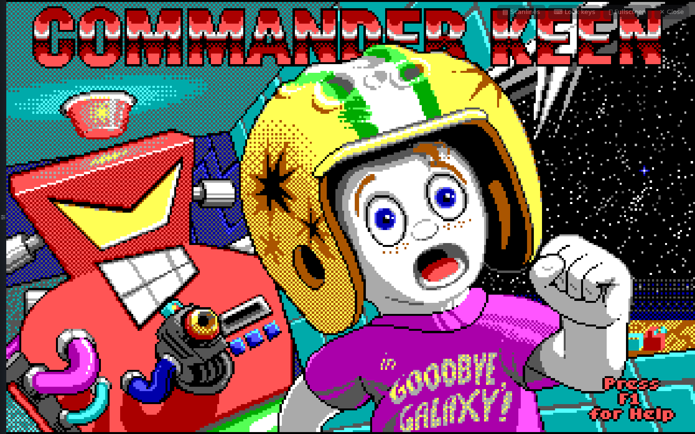

# (Unofficial) ExodiumWeb


### Storyline:

<div style="font-size: 0.88em; border-left: 4px solid #007acc; padding-left: 14px; color: #d1d1d1; margin: 20px 0; max-width: 650px; line-height: 1.5 
Hi all
<br>
Before you scroll any further, a couple of words that are actually written by me:

<b>What is ExodiumWeb?</b>
<br>
Exodiumweb delivers a self-hosted web interface based on  <a href="https://github.com/tvollstaedt/exodium">Exodium</a>  desktop launcher for your <a href="https://www.retro-exo.com/exodos.html">eXoDOS</a> library. Currently webinterface is functional and currentely all games will go through a testing cycle to see if theyt are working on JS-Dos whifch is webbased version of Dosbox but with limited features. 

<b>But why building a self-hosted application></b>
<br>
As a big fan of the <a href="https://www.retro-exo.com/exodos.html">eXoDOS</a> community and the <a href="https://github.com/tvollstaedt/exodium">Exodium</a> launcher, I wanted to have something that I don't need to install or to run from my desktop but from the browser and have it available anywhere I am. 

Please check out the docs and looking forward to see contributions, re-use, building a better platform or simply enjoyment for yourself!

<em>A big thanks to @tvollstaedt for his work and to the entire eXoDOS community for their efforts!</em>
Enjoy!
<details>
  <summary><strong>Current features (Click to expand)</strong></summary>
  <ul style="margin-top: 10px;">
    <li>Most of the games will work with the js-dos implementation. But bare in mind it has its limitations such as no midi  . Games are working already (compiling a compatibility list through automated/manual playtesting).</li>
    <li>Functional UI, including support for save games.</li>
    <li>In-game settings bar to adjust Graphical, HID, and Cycle settings.</li>
    <li>'CRT Overlay' (Sorry, couldn't hold myself 😉. It's a visual layer on top of the picture: no blur, etc.)</li>
    <li>Large games download entirely before running. For multi-disc launchers (like C&C), you can pick campaign options to minimize download size. Downloads are removable per game in the UI.</li>
    <li>Automated testing using Claude to fix games on the fly, with results pushed to the compatibility list.</li>
    <li>Your local library remains untouched. Fixes are included directly in the commits.</li>
    <li><em>(Networking is not yet included due to limited time).</em></li>
  </ul>
</details>
<hr style="border: 0; border-top: 1px dashed #1e1d1d; margin: 10px 0;"/>

</div>


## What it is

**Browse the whole eXoDOS library and play the games in your browser.**
Self-hosted, multi-user, nothing to install on the client.


|  |  |  |
|---|---|---|
| Game detail: box art, video, gallery, manual | Commander Keen 5 in js-dos | Reading Room: eXo's magazines and books |

- **The whole eXoDOS 6.04 catalogue**, with search, genres, playlists, box art, videos and manuals.
- **Games run in the browser** with [js-dos 8](https://js-dos.com) (DOSBox in WebAssembly). The server translates each game's own eXo `dosbox.conf` and launcher on the fly.
- **Per-user** libraries, favourites and saves behind your login proxy, or a single user on a trusted LAN.
- **Your collection stays untouched.** It is mounted read-only, and every fix is applied to a cached copy.
- Big games download in pieces and stay in the browser. For multi-disc launchers, such as C&C and Red Alert, you pick one campaign and only that disc is downloaded.

Status: **MVP in progress.** Milestones with screenshots: [docs/progress](docs/progress/README.md).


## Known limitations
 
- **No MIDI music.** The js-dos player has its limits; MIDI is one of them.
- **No networking** or multiplayer yet.
- **Not every game runs yet.** Check [Tested games](#tested-games) below.
- **HTTPS or `localhost` only.** The player needs `SharedArrayBuffer`, which browsers only allow on secure origins.

## Tested games

The headless test plays each game up to a menu or into the game. Every tested game has its own page with the fixes made for it.
Overview, global fixes and how to add a game: **[docs/compatibility](docs/compatibility/README.md)**.

<!-- generated:tested (node tools/compat-index.mjs) -->
🟩🟩🟩🟩🟩🟩🟩🟩🟨🟨🟨🟨🟨🟨🟨🟨🟨🟨🟧🟥 **384 of 7,666 games tested:** 🟢 162 playable · 🟡 204 boots · 🟠 2 partial · 🔴 16 not supported. [All tested games](docs/compatibility/GAMES.md) · [searchable table](docs/compatibility/games.csv)
<!-- /generated:tested -->

A game misbehaving? [Open an issue](https://github.com/smii/exodiumweb/issues/new/choose) with the game's name. The app's bug button and **Settings → About** link to the same place.

## Quick start

You need your own **eXoDOS 6.04 collection**: the folder that holds `eXo/` and `Content/`. None of it ships with this repo or the image.
The browser must reach the app over **HTTPS or `localhost`** due to functionality constrains ( `SharedArrayBuffer` requiires one of the both.

```bash
docker build -t exodiumweb .
docker run -d --name exodiumweb -p 127.0.0.1:8080:8080 \
  -v /path/to/eXoDOS:/collection:ro \
  -v exodiumweb-state:/state -v exodiumweb-cache:/cache \
  -e SINGLE_USER=player exodiumweb          # → http://localhost:8080
```

<details>
<summary><b>docker compose</b> and <b>Helm</b></summary>

```bash
cp .env.example .env          # set EXODOS_PATH
docker compose up -d --build  # binds 127.0.0.1:8080, named volumes for state + cache
```

```bash
helm install exodiumweb charts/exodiumweb -n exodiumweb --create-namespace \
  --set image.repository=registry.example.com/exodiumweb --set image.tag=0.1 \
  --set collection.hostPath=/mnt/exodos \
  --set ingress.enabled=true --set ingress.host=exo.example.com
```

The collection can be a `hostPath`, an `nfs` share or an existing PVC. All options are in [`values.yaml`](charts/exodiumweb/values.yaml).
</details>

**Users:** the app has no login of its own.
- `SINGLE_USER=<name>` makes everyone that user. Use it only on `localhost` or a trusted LAN.
- For several users, leave it empty and put a forward-auth proxy in front (Authelia, oauth2-proxy, Authentik). The proxy must set `Remote-User` (`USER_HEADER` renames it) and overwrite any value the client sends.

## Docs

| | |
|---|---|
| [MANUAL](docs/MANUAL.md) | Using the app: library, playing, saves, downloads, troubleshooting for players |
| [DEPLOY](docs/DEPLOY.md) | Sizing, login proxies, backup, upgrades |
| [CONFIGURATION](docs/CONFIGURATION.md) | Every setting and URL parameter (`?disc=`, `?cmd=`, `?tune=`) |
| [ARCHITECTURE](docs/ARCHITECTURE.md) | Server, config translation, launcher patching, bundles, downloads |
| [TROUBLESHOOTING](docs/TROUBLESHOOTING.md) | Black screens, graphics and audio, the headless probe (`test/render-probe.mjs`) |
| [compatibility](docs/compatibility/README.md) | Overview of tested games, full A–Z list and searchable table, fix per game, global fixes |
| [progress](docs/progress/README.md) | Milestones with screenshots and recordings |
| [AI-ASSISTED-DEVELOPMENT](docs/AI-ASSISTED-DEVELOPMENT.md) | How it was built with Claude Code; agent kit, test harness, debugging method, deploy loop, reuse with other agents |
| [CLAUDE.md](CLAUDE.md) · [skill](.claude/skills/exodiumweb-troubleshooting/SKILL.md) | For AI coding agents (also read via [AGENTS.md](AGENTS.md)): rules, layout, the game-debugging method |

## Development

Needs Node ≥ 22.13.

```bash
cd ui && npx pnpm@9 install && npx pnpm@9 build && cd ..
cd server && npm run fetch-data && npm run fetch-jsdos
cp dev.env.example dev.env    # point COLLECTION_ROOT (or COLLECTION_SSH) at your collection
npm run dev                   # http://localhost:8090
```

| Folder | What |
|---|---|
| `ui/` | Exodium v0.15.2 frontend plus `web-shims/` for the 7 Tauri modules it imports. Local changes are listed in [`ui/UPSTREAM.md`](ui/UPSTREAM.md). |
| `server/` | Dependency-free Node server: Exodium's commands over HTTP, per-user SQLite, bundles built from the collection, the js-dos player |
| `charts/exodiumweb/`, `compose.yaml` | Helm chart and docker compose setup |
| `test/` | Playwright: README screenshots, recordings, the detached render probe (`run-detached.sh`) |
| `deploy/` | The author's own homelab build Job (kaniko → Harbor); an example only |
| `poc/` | The original proof of concept and its findings ([poc/README.md](poc/README.md)) |

## Where it comes from

ExodiumWeb is [**Exodium**](https://github.com/tvollstaedt/exodium) by tvollstaedt, made into a web app. Exodium is a Tauri desktop launcher for the eXo collections (SolidJS + Rust) that starts games in a native DOSBox. Kudos for the great frontend!
I wanted something self-hosted instead of a desktop app. AI coding assistants (Claude Code and GitHub Copilot) did most of the refactoring under human direction:

| Exodium (desktop) | ExodiumWeb (browser) |
|---|---|
| Tauri app, installed per machine | One server, any browser on the network |
| Rust backend (~100 Tauri commands) | Node server answering the same commands over HTTP |
| Native DOSBox / DOSBox-X | js-dos 8 in the browser |
| Single user, local files | Per-user libraries, favourites and saves |

*Unofficial: not affiliated with the Exodium project or the eXo team. The Exodium UI is used under its MIT licence (`ui/UPSTREAM-LICENSE`). Bugs in ExodiumWeb belong in [this repo's issues](https://github.com/smii/exodiumweb/issues), not upstream.*
