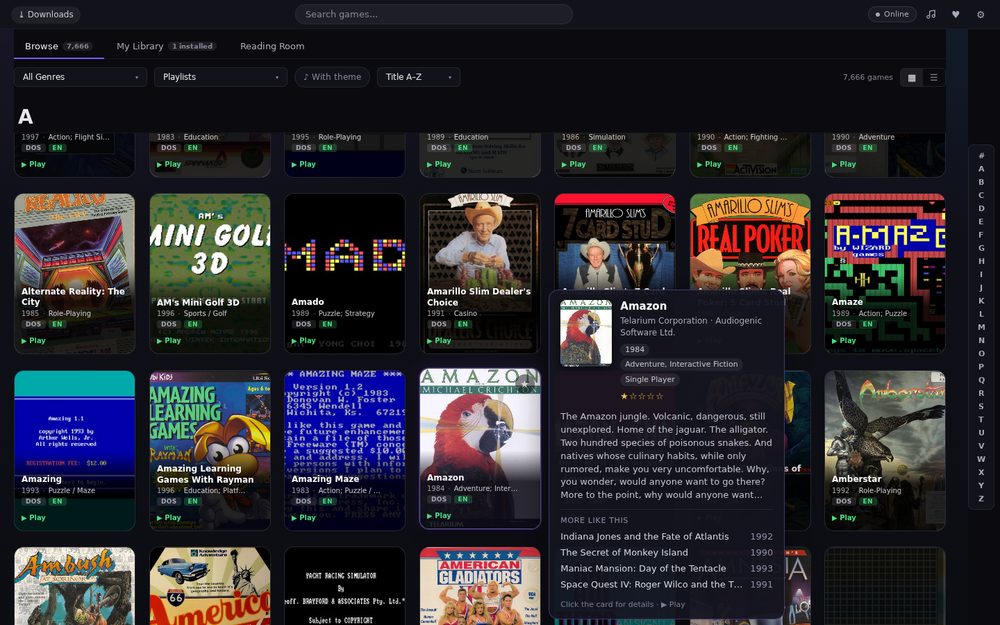
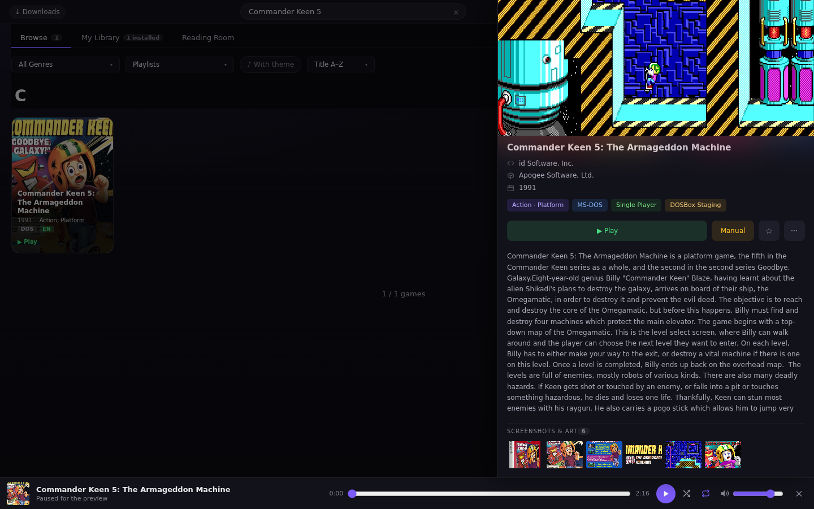
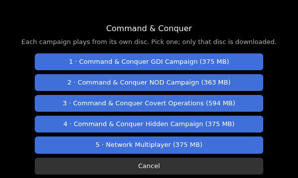
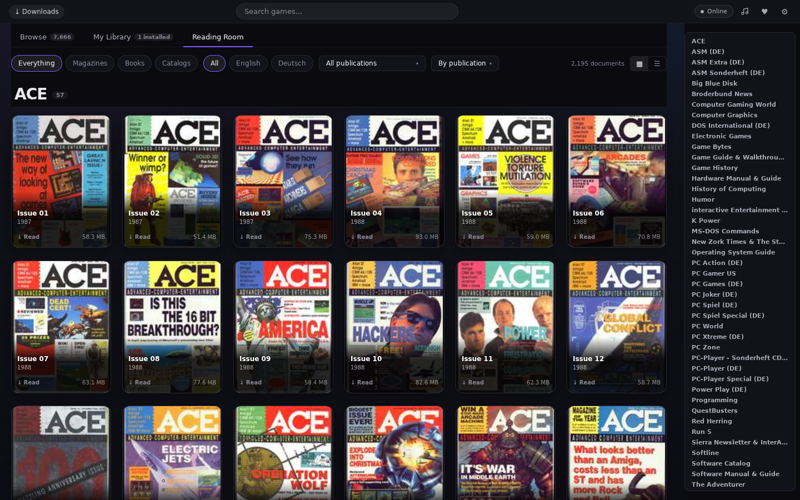

# ExodiumWeb user manual

How to find, start and play eXoDOS games in ExodiumWeb, and what to do when a
game doesn't behave. For installing the server, see [DEPLOY](DEPLOY.md).

**Contents:** [The library](#the-library) · [Game details](#game-details) ·
[Playing a game](#playing-a-game) · [The player toolbar](#the-player-toolbar) ·
[Saves](#saves) · [Large games and downloads](#large-games-and-downloads) ·
[Reading Room](#reading-room) · [Settings](#settings) · [Phones and tablets](#phones-and-tablets) ·
[Troubleshooting](#troubleshooting) · [Reporting a problem](#reporting-a-problem)

## The library

- **Browse** shows every game in the collection (7,666 in eXoDOS 6.04). Sort
  by title, year or rating; jump with the **A–Z bar**; filter with the
  **All Genres** drop-down and the other filters above the grid.
- **Search** (top bar) matches titles as you type.
- **Rest the pointer on a cover** to slide out a panel with the description,
  credits, rating and "more like this" picks. Click the cover to open the game.
- **My Library** holds your favourites, **Recently Played** and the games
  stored on this device. Every user has their own library.
- The **🐞 button** in the top bar opens a new ExodiumWeb issue. The ♫ button
  plays the games' theme music.
- The browser's **Back** button stays inside the app. It closes the open
  game, gallery, manual or dialog one at a time before it leaves the site.

## Game details

The detail panel shows the description, box art, the preview video, a
screenshot gallery (click a picture for the lightbox) and the **manual**, which
opens in the built-in PDF reader. Many games ask for a word from the manual as
copy protection, so keep it at hand. "Covered in" lists magazine articles about
the game that you can open in the Reading Room.

**Play** starts the game. Some games show extra launch choices (for example a
3dfx version) next to it.

## Playing a game

1. Press **Play**. The game's files are prepared on the server and loaded
   into the player. Small games start in a few seconds.
2. **eXo's launcher menu** comes first for most games. Pick an option with
   its number key: usually **1** starts the game, and the others start setup,
   a different sound card or an expansion. Options marked **(no music)** are
   for MT-32 or Sound Canvas music, which the browser player can't play. Pick
   the Sound Blaster option instead.
3. Many old games then ask **setup questions** (graphics card, drives, sound).
   Answer as for a VGA PC with a hard disk and a Sound Blaster.
4. If the player shows **🔇 Click or press a key for sound**, do that: the
   browser only starts sound after a click or key press.

**Multi-disc games** (Command & Conquer, Red Alert) first ask which campaign
to play. Only that campaign's disc is downloaded, with its size shown on
each button, and the game starts straight in that campaign. Pick again next
time to play another one.

## The player toolbar

The toolbar sits at the top right of the player and fades out while you play.
Move the mouse to bring it back.

| Button | What it does |
|---|---|
| ▤ **Scanlines** | CRT scanlines on or off, lined up with the game picture. |
| ⛶ **Fullscreen** | Fullscreen without F11. |
| ⌨ **Lock keys** (fullscreen, Chromium browsers) | Sends Esc, Ctrl+W and similar keys to the game instead of the browser. **Hold Esc** to leave fullscreen. |
| ✕ **Close** | Saves your progress, stops the game and returns to the library. |

Your progress is saved when you leave a game with **Close**, with the
browser's Back button, or by quitting it from the game's own menu.

## Saves

- Saves are kept **on the server, per user**. Saving inside the game works as
  on a real PC. Everything the game wrote is uploaded when you close it, and
  every so often while you play.
- **Quitting from the game's own menu saves too.** When a game exits to DOS,
  the player notices, shows *Saving…*, uploads your progress and goes back
  to the library by itself. There's no need to press **Close** afterwards.
- **Leaving any other way can lose progress.** Closing the browser tab,
  reloading the page or losing power keeps only the last automatic save.
- They follow you to any browser or device where you log in as the same user.
  Other users start with a clean copy of the game.
- Your saves are stored apart from the game collection, which is never
  changed. A fix to a game doesn't touch your saves.

## Large games and downloads

Games over about 300 MB (mostly CD games) are **downloaded once** into the
browser's own storage. The first start asks first, then shows a progress bar.
After that the game starts from this device without downloading again.

- The **⤓ Downloads** link (top left of the library) lists the stored games
  with their sizes, with **Remove** per game and **Remove all**.
- Removing a download doesn't remove your saves.
- After an app update that changes how games are prepared, a stored game may
  download once more.
- A big game needs free memory too: about five times its size while it is
  unpacked. Close other heavy tabs before starting a 500 MB game.

## Reading Room

eXo's magazines, books and catalogues (44 publications, about 2,200 issues),
browsable by publication and language. An issue opens in the reader when
eXo's Media Pack is part of the collection. Otherwise the reader says it
isn't available.

## Settings

The settings button in the top bar opens Settings. Settings that only matter to the desktop
Exodium (download folders, torrents, seeding) have no effect here.
**About** links to the issue tracker, the [compatibility list](compatibility/README.md)
and the source, and credits the original Exodium.

## Phones and tablets

The library fits two covers across, and game details fill the screen. The
player toolbar shows icons only. Games that need a keyboard need a hardware
keyboard. Big games may not fit in a phone's browser memory.

## Troubleshooting

First check the game in the **[compatibility list](compatibility/README.md)**.
It shows how far the game was tested and any known quirk.

| What you see | What to do |
|---|---|
| **Black screen with a blinking cursor** after the launcher menu | The game ended or couldn't start. Press **Close** and try another launcher option. If option 1 always does this, report the game. |
| **Black screen with a cursor after quitting** a game | Normal: the game returned to DOS. Press **Close**. |
| **No sound** | Click inside the game once (browsers only start sound after a click). In the launcher, pick a Sound Blaster option, not MT-32 or Sound Canvas. |
| **Keys don't reach the game** | Click the game picture first. For Esc, Ctrl and similar keys, use **Fullscreen** + **Lock keys**. |
| **The game asks for a word, page or symbol** | Copy protection: open the **manual** in the game's details. |
| **The game sits on its intro** | Press Esc, Space or Enter. Some intros can't be skipped and just take a while. |
| **"Play" does nothing / the tab crashes on a big game** | The browser ran out of memory. Close other tabs and try again, or try on a computer instead of a phone. Multi-disc games: pick one campaign. |
| **The download stops or starts over** | Check your connection and press Play again. Downloads resume in pieces, so a retry continues where it stopped. |
| **Slow or choppy 3D game** | Late-90s 3D and 3dfx games push what a browser can emulate. Pick the non-3dfx launch option, or lower the game's own detail settings. |
| **My save is gone** | Saves belong to the user you log in as. Check you're logged in as the same user, and that you left the game with **Close**, Back, or the game's own Quit last time (not by closing the tab). |
| **The page says it needs HTTPS** | The player only works over HTTPS (or `localhost`). Ask whoever runs the server. |

Server-side problems (graphics settings, launcher patches, the headless test
probe) are covered in [TROUBLESHOOTING](TROUBLESHOOTING.md).

## Reporting a problem

Use **🐞 Report an ExodiumWeb issue** in the top bar, or **Settings → About →
Report an issue**. Give the game's name, the launcher option you picked,
where it stopped, and your browser and device. A screenshot helps. Fixes and
test results go into the [compatibility list](compatibility/README.md).
