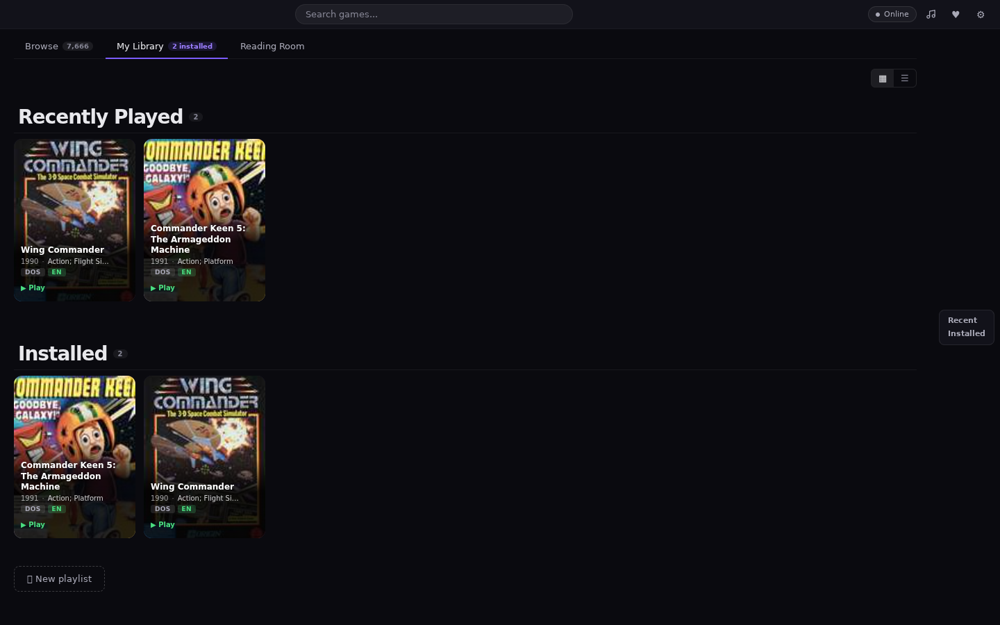
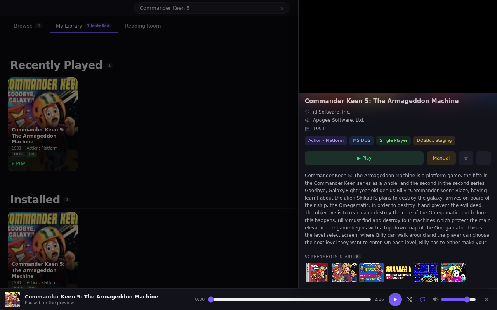
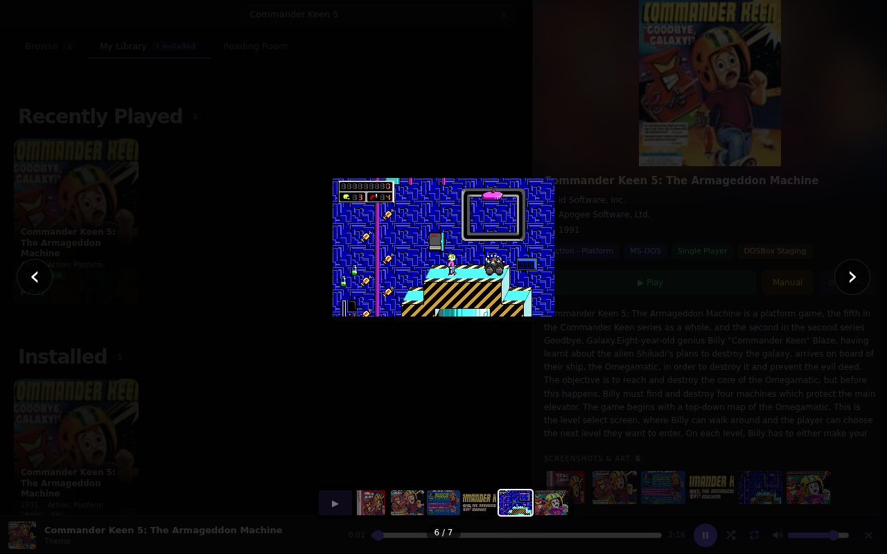
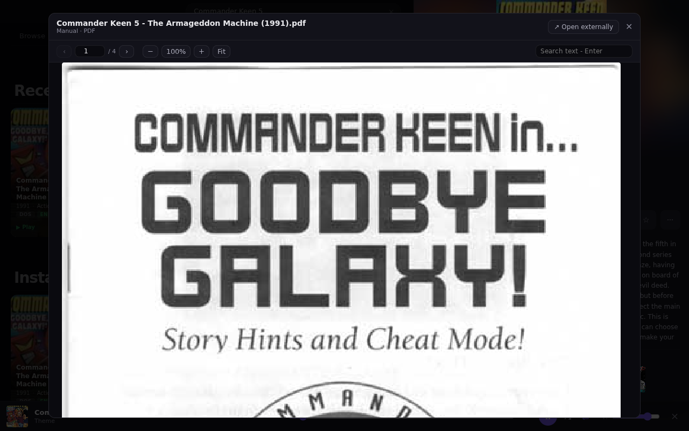
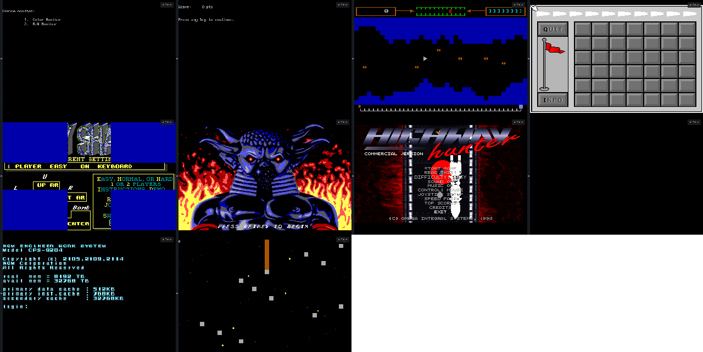
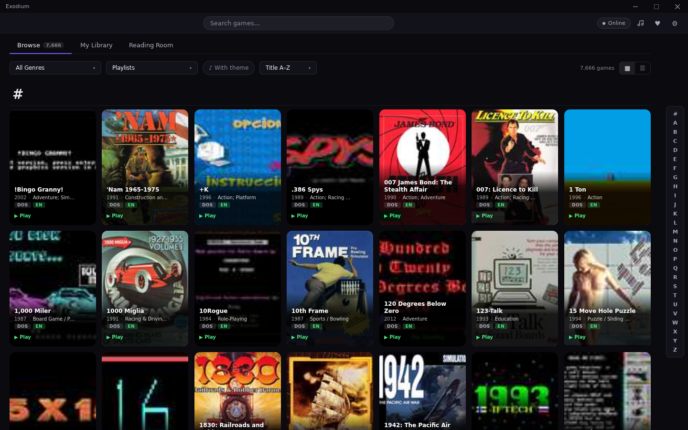
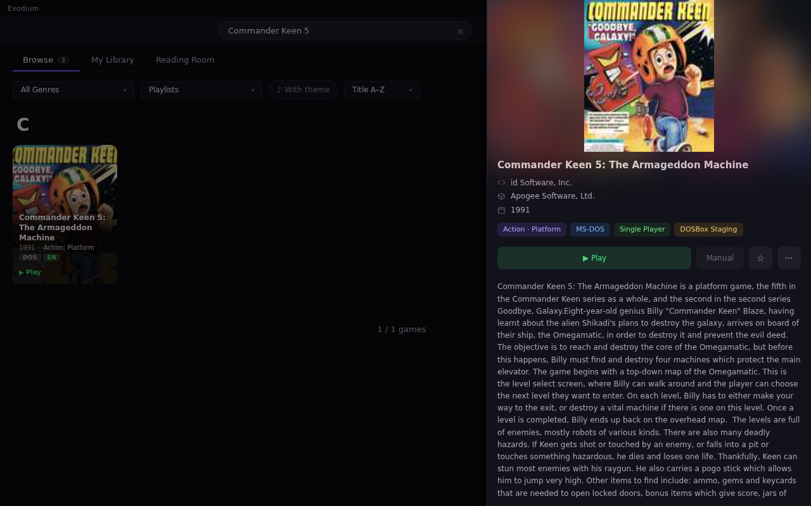
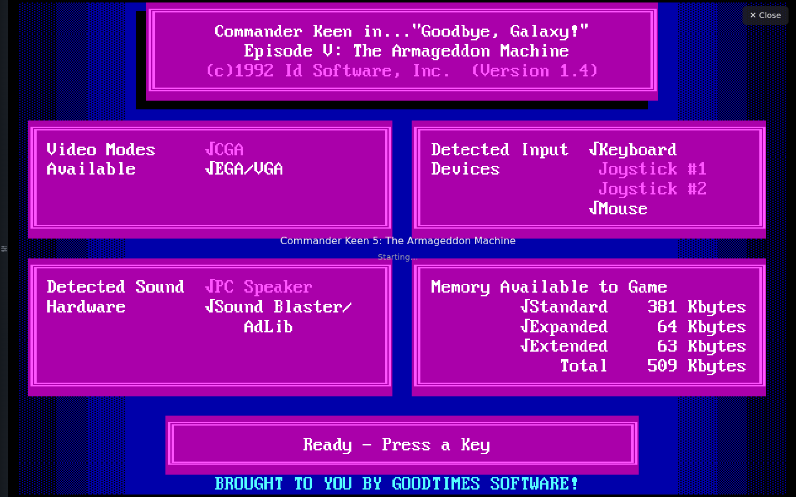

# notexoweb progress

Screenshots and screen recordings from each milestone, newest first. Recordings
are made with the headless test browser (`test/record-play.mjs`, software-only
WebGL, so real browsers run smoother). Each GIF has the full `.webm` next to it.

---

## Milestone 2 — media, manuals, per-user saves, first compatibility sweep (2026-10-08)

Everything Exodium shows next to a game now comes straight from the NAS's
eXoDOS 6.04 files (`XODOSMetadata.zip` and the per-game `GameData` zips):
screenshot/box-art gallery with a lightbox, the PDF manual in the built-in
reader, the preview video in the detail panel and the theme music in the
bottom player. The desktop window buttons are gone.

Saves are kept **on the server, per user** (`Remote-User` header from the
login proxy): leaving a game uploads its changed files, starting it again
restores them. Another user starts with a clean copy. Tested automatically
(`test/test-saves.mjs`).

**Recording: detail panel → video preview, gallery, lightbox, manual, theme music**
([full video](02-media.webm))

**My Library — Recently Played and Installed**

**Detail panel with video preview and theme music**

**Gallery lightbox**

**Manual reader**

**Compatibility sweep, first batch (10 random games, seed 1)**

Each game is started straight in the player, given `1` and Enter for eXo's
launcher menu, then photographed 12 s later. 9 of 10 reach a title screen,
menu or prompt; Poker Relay stays black (to investigate). Larger batches are
next.

Known issues:
- Wing Commander starts fine from its own folder but not yet through eXo's
  `run.bat` launcher on plain DOSBox.
- js-dos's DOSBox-X build crashes on some eXo launcher batch commands, so
  DOSBox-X is only used for 3dfx games; MT-32 music falls back to Sound
  Blaster/AdLib for now.

---

## Milestone 1 — Exodium UI in the browser, games play in-app (2026-10-07)

The unchanged Exodium frontend, served by the notexoweb server against the
**eXoDOS 6.04** collection on the NAS (7,666 games). Search, open the detail
panel, press **Play**: the game boots in an in-app js-dos player; **Close**
returns to the library.

**Recording: search → detail → Play → Commander Keen 5 running → close**
([full video](01-keen5-play.webm))

**Library (Browse, title A–Z)**

**Detail panel**

**In the player**

Known issues in this milestone (fixed or planned next):
- "Starting…" stayed on top of the game (fixed after this recording).
- The desktop window buttons (minimise/maximise/close) still show top right.
- Manuals, media gallery, video previews and theme music aren't wired up yet.
