# (Unofficial) ExodiumWeb — progress

Screenshots and screen recordings from each milestone, newest first. Recordings
are made with the headless test browser (`test/record-play.mjs`, software-only
WebGL, so real browsers run smoother). Each GIF has the full `.webm` next to it.

---

## Milestone 7 — scanlines, downloads, DOS tuning, 3dfx probes (2026-10-09)

- **Scanlines** now line up with the game canvas: `alignScan` in `player.html`
  sizes the overlay to the canvas by JS instead of the whole container.
- **Downloads** (`downloads.js`): game zips are fetched in 8 MB `Range`
  pieces (4 retries each) and then stored with `caches.put`. A single
  request was cut off at ~14 MB through Traefik over HTTP/2.
- **Duke Nukem 3D**: `duke3d.cfg` is rewritten to `ScreenMode=0` (320x200)
  by `patchBatchFiles`; `BATPATCH_VERSION=5` so cached patches refresh.
- **Translator** (`translate.mjs`): machine `svga_s3` maps to `vesa_nolfb`,
  and `memsize` is capped at 63 for the dosbox backend.
- **Player `close()`** has timeouts: save 8 s, stop 3 s, 15 s backstop.
- **Testing hook**: `?tune=section.key=value|...` overrides conf values.
- **Quake**: the eXo zip has no GLQuake/Glide build, so it cannot run in
  3dfx mode (CD music works).
- **Probes**: `test/cv-probe.mjs` and `test/dfx-probe.mjs`. 3dfx check:
  Furcol and Tomb Raider Gold render; Blood, Descent II and Shadow Warrior
  reach their menus. Shadow Warrior 3DFX hit a wasm `unreachable` in
  headless (unverified in a real browser).
  **Correction (2026-10-10):** rendering a frame was insufficient evidence
  for Tomb Raider compatibility: its accelerated path has a white intro
  and missing menu lettering. See [the reproduction and non-3dfx
  fallback](../TROUBLESHOOTING.md).

---

## Milestone 6 — sound fixed, 3dfx list completed (2026-10-09)

**Sound.** On the live site (https) js-dos plays audio through a worklet
that runs at a fixed 44,100 samples per second and doesn't resample. About
1,250 eXo configs set DOSBox's mixer to 48,000 or 49,716 Hz (eXo targets
DOSBox Staging/ECE), so the emulator produced audio faster than the browser
played it: lower pitch, and the overflowing queue dropped chunks. Every
config now runs the mixer and the sound chips at 44,100 Hz
(`server/src/translate.mjs`).

Measured with `test/sound-probe.mjs`, which counts the samples the emulator
sends and how loud they are, nine games across three eras (all now ~44,100
samples/s, matching the browser, and sound in every one):

| Era | Game | Mixer rate in eXo's config | Samples/s now |
|---|---|---|---|
| 1980–1990 | Space Quest III · Prince of Persia · Ultima VI | 48,000 · 48,000 · 48,000 | 44,083 · 44,100 · 43,845 |
| 1990–1994 | Commander Keen 4 · Commander Keen 5 · DOOM | 48,000 · default · 49,716 | 44,097 · 44,094 · 44,077 |
| 1995–2000 | Duke Nukem 3D · Tyrian 2000 · Rise of the Triad | default · 49,716 · default | 44,107 · 44,065 · 44,098 |

Before the fix Keen 4 measured 47,923 and DOOM 49,563 samples/s going into
the 44,100 worklet.

Keen 4 and 5 detect the Sound Blaster/AdLib and play AdLib music in the
levels (the title screen and menus have none, as on real hardware).

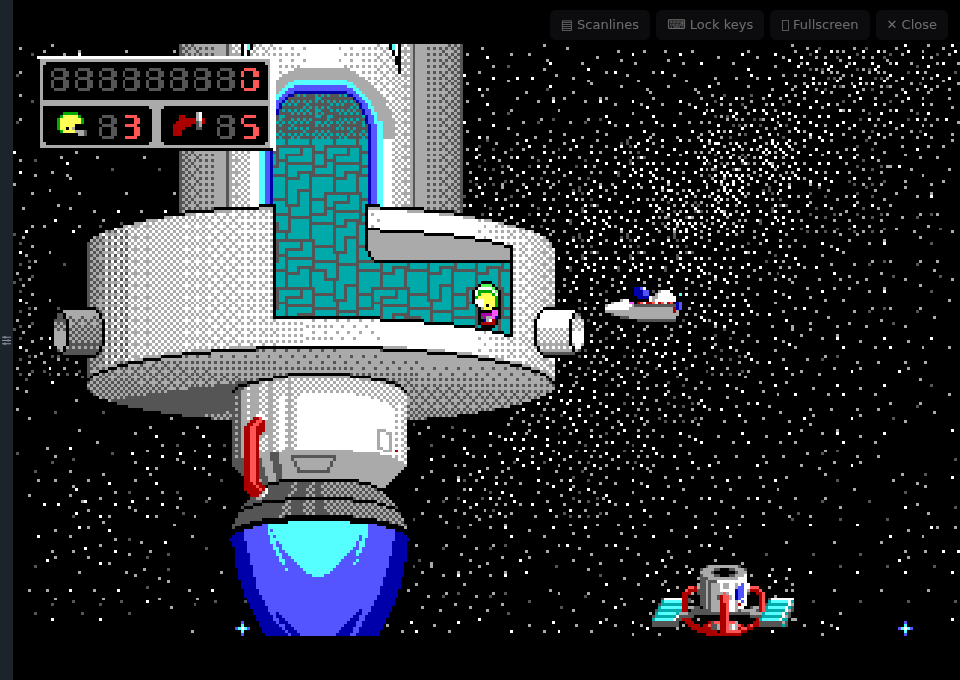

The player also keeps retrying to start the audio on every click, tap or
key while the browser holds it back (js-dos tried once only), and shows
"Click or press a key for sound" until it plays.

**MT-32 and Sound Canvas: no music.** Neither js-dos build contains a MIDI
synthesizer (no munt, no FluidSynth), so eXo's "w/ MT-32" / "w/ Sound
Canvas" launcher choices start the game without music. Launchers now mark
those entries, so the Sound Blaster entry is the obvious pick:

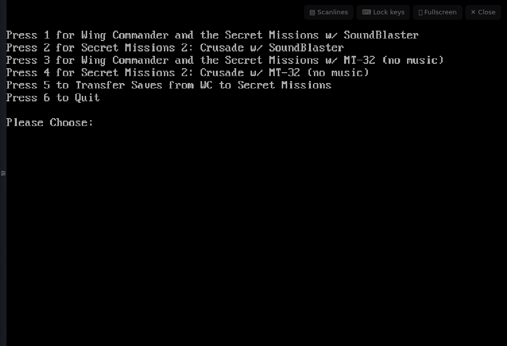

**3dfx Games: 29 → 36.** The list is eXo's own curated LaunchBox
playlist. Seven more games ship with a 3dfx card turned on in eXo's own
configs but were never added to it: Descent: eXoHOG, Flying Corps: Gold,
NBA Live 97, NIRA: Intense Import Drag Racing, System Shock, The Varginha
Incident, Quake II (Q2DOS). They are now added to every user's 3dfx
playlist (`server/src/curated.mjs`). Most 3dfx titles were Windows 9x
games, which aren't part of eXoDOS.

---

## Milestone 5 — sharp covers, Back inside the app, phones (2026-10-09)

**Sharp covers.** The library used Exodium's bundled 75×120 thumbnails, so
covers looked blurry next to the full-size gallery. Covers now come from
each game's box art in eXo's metadata, scaled to 480 px wide the first time
they're shown and then cached on the server
(`server/src/posters.mjs`). Games without box art fall back to a title
screenshot, or else to the old thumbnail.

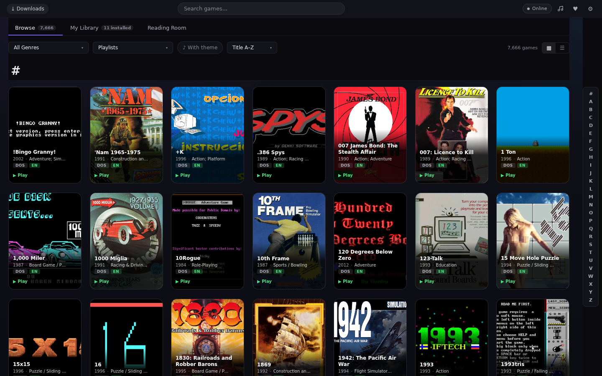

**Back stays in the app.** Switching tabs and opening game details, the
gallery, a manual, a dialog or a magazine each add a browser history step.
Back closes them one at a time, then returns to the previous tab, and only
then leaves the site. Closing something with its own ✕ removes its step,
so Back never lands on something already closed.

**Phones.** Two covers across, a slim A–Z bar, tabs and filters that fit
the screen, game details that fill the screen, and the Downloads link moved
out of the search box's way. The Reading Room uses its publication drop-down
instead of the side list. The hover panel stays off on touch screens, and
the player toolbar shows icons only.

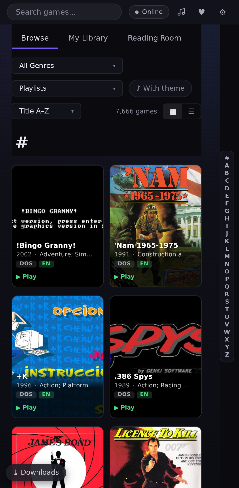
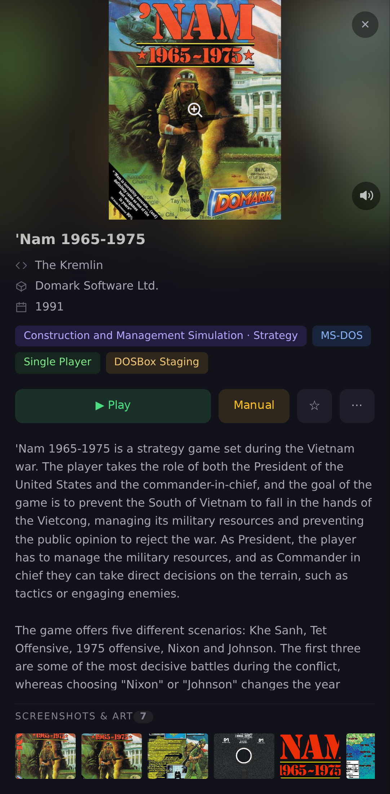
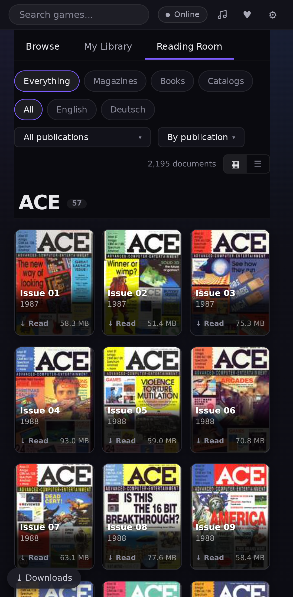

---

## Milestone 4 — library look, hover info, Reading Room, CRT scanlines (2026-10-09)

More room between games, framed cards with a soft glow on hover, and a
background with some depth. Resting the pointer on a game slides out a panel
with its description, credits, rating and "more like this" picks.

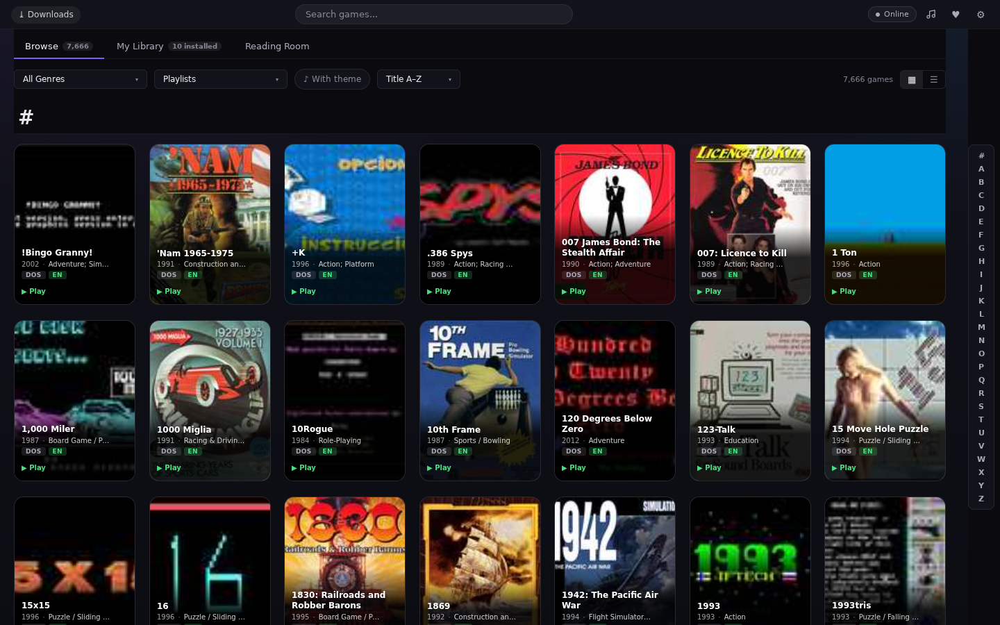

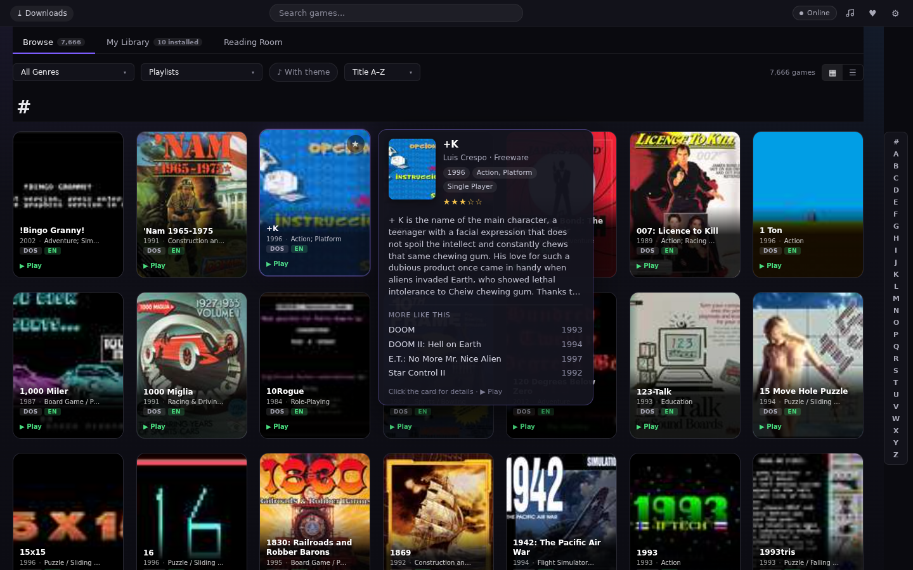

**Reading Room** now works: 44 publications and 2,195 magazines, books and
catalogs from eXo's index, browsable by publication and language with their
covers. Issues open from eXo's Media Pack once it's in the collection (it isn't
yet); until then the reader says so. Game details also list magazine coverage
("covered in ASM 12/1990, page 32").

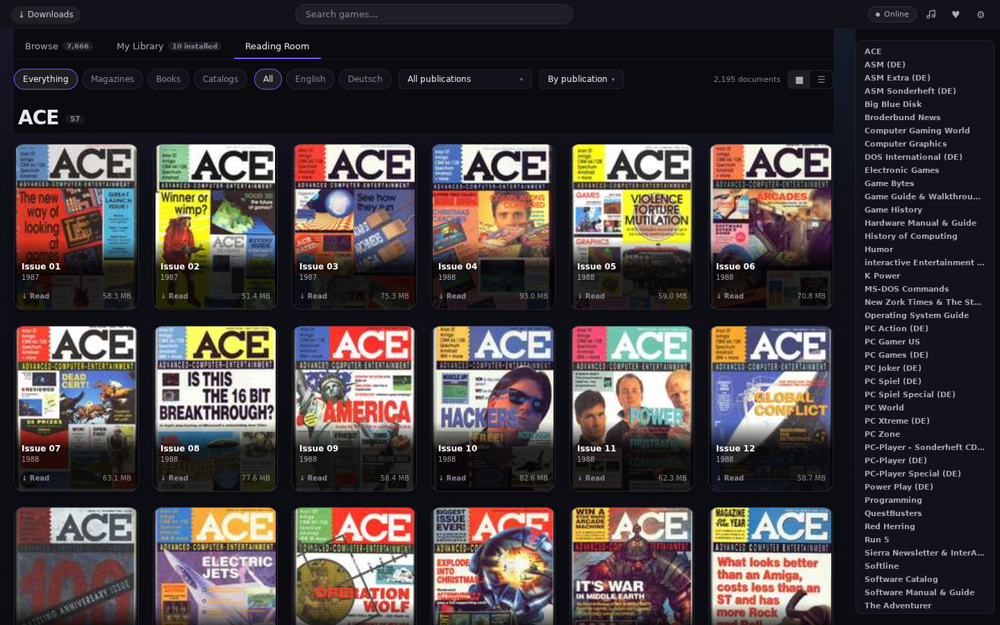

**Player toolbar**: CRT scanlines on/off, fullscreen, and keyboard lock
(Chromium: Esc, Ctrl+W and friends go to the game; hold Esc to leave).

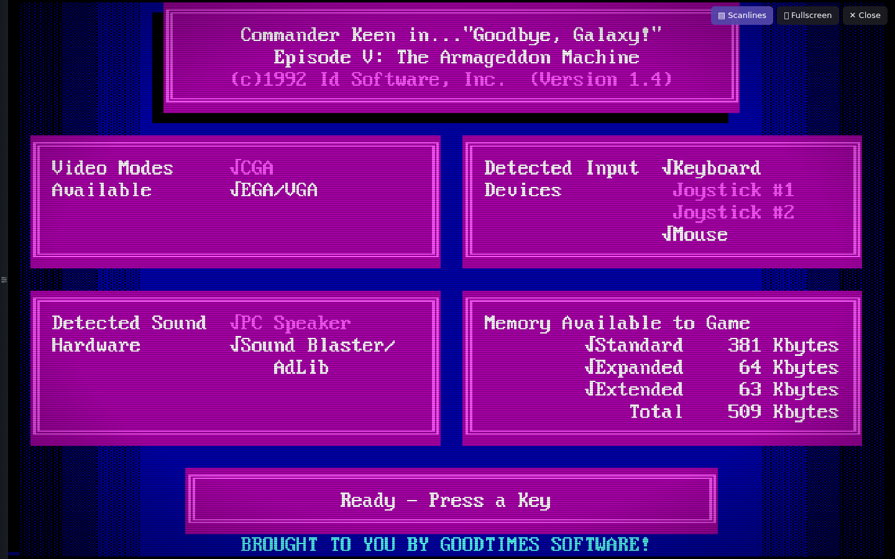

---

## Milestone 3 (in progress) — large games: download once, keep on the device

About 700 eXoDOS games are over 300 MB (mostly CD games; Monkey Island is
1.6 GB). Instead of loading those on every start, the player now asks once,
downloads the game with a progress bar into the browser's own storage, and
starts it from there the next time. A **Downloads** page (link at the top
left of the library) lists the stored games with their sizes, with
**Remove** per game and **Remove all**. Saves stay on the server either way.

**The question before a large game downloads**

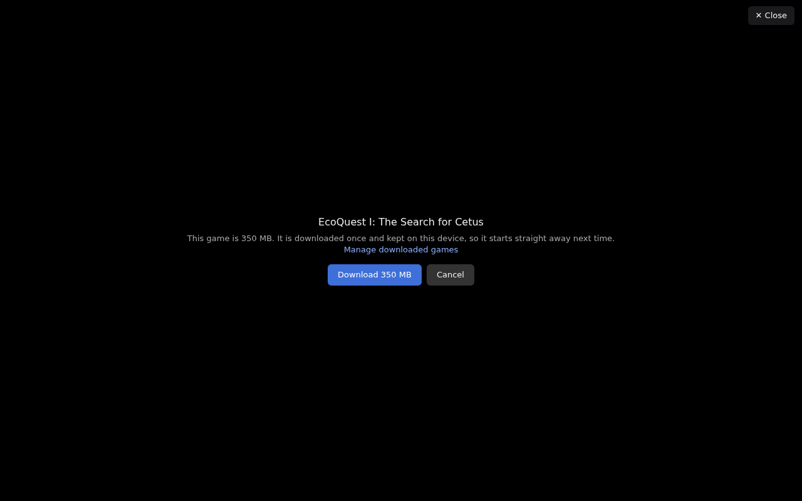

**Downloading**

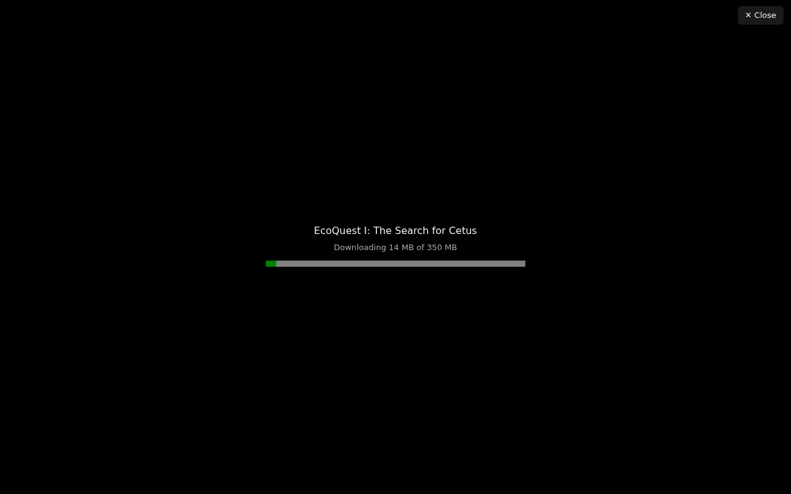

**Recording: EcoQuest I (350 MB), first start** — library → Play → the
question → download → eXo's launcher menu; ready 43 s after pressing Play
([full video](03-ecoquest-first-start.webm))

**Recording: EcoQuest I, second start — from this device's storage** — no
question, no download, ready in 26 s, then 1 (Sound Blaster) and the
intro plays ([full video](03-ecoquest-from-storage.webm))

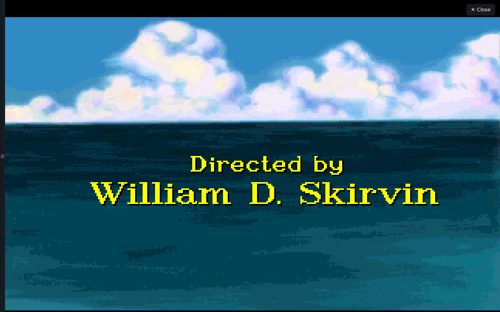

**Recording: Master Levels for DOOM II (333 MB), first start** — download,
then eXo's launcher; ready 60 s after pressing Play
([full video](03-doom2-master-first-start.webm))

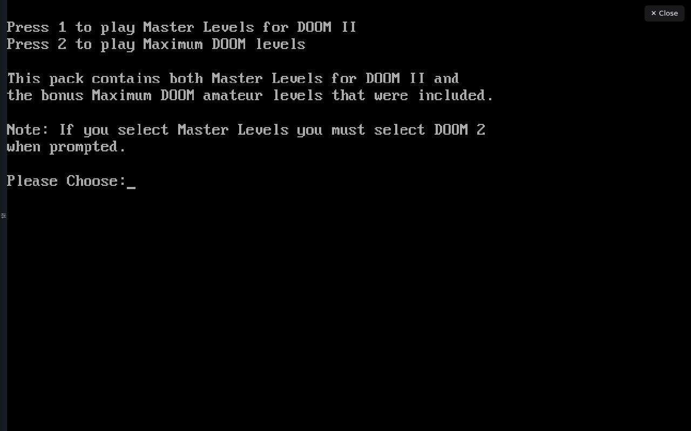

Notes:
- Recorded in the headless test browser (software rendering, no GPU), so a
  real browser starts faster. The test pod's memory limit was raised to
  10 GiB for this; each run peaked around 4.3 GiB for the whole pod.
- Master Levels' launcher goes on to a sound-card question and a level
  picker; the scripted key presses didn't get through the whole sequence yet
  (timing), so the game itself isn't in the recording.

---

## Milestone 2 — media, manuals, per-user saves, first compatibility sweep (2026-10-08)

Everything Exodium shows next to a game now comes straight from the NAS's
eXoDOS 6.04 files (`XODOSMetadata.zip` and the per-game `GameData` zips):
screenshot/box-art gallery with a lightbox, the PDF manual in the built-in
reader, the preview video in the detail panel and the theme music in the
bottom player. The desktop window buttons are gone.

Saves are kept **on the server, per user** (`Remote-User` header from the
login proxy): leaving a game uploads its changed files, starting it again
restores them. Another user starts with a clean copy. Tested automatically
(`test/test-saves.mjs`).

**Recording: detail panel → video preview, gallery, lightbox, manual, theme music**
([full video](02-media.webm))

**My Library — Recently Played and Installed**

**Detail panel with video preview and theme music**

**Gallery lightbox**

**Manual reader**

**Compatibility sweep, first batch (10 random games, seed 1)**

Each game is started straight in the player, given `1` and Enter for eXo's
launcher menu, then photographed 12 s later. **All 10 boot.** Poker Relay
(black in the sheet) just starts slower than the 12 s wait; given 25 s it
shows its graphics-card menu. Larger batches are next.

Batches 2 and 3 (seeds 2 and 3, 10 more games): all boot — Lemmings 2,
Carmen Sandiego Deluxe, RedCat, Many Faces of Go, Miramar and others.
**20 of 20 sampled games start so far.**

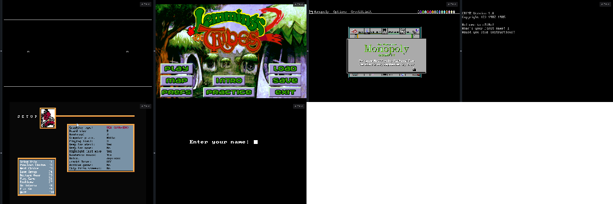

**Wing Commander through eXo's own launcher**

js-dos freezes when a batch file runs a program from an `IF` line
(`IF %CHEAT%==N wc`), which eXo launchers do all the time. Bundles now
rewrite those lines into an equivalent `IF … GOTO` form
(`server/src/batpatch.mjs`). With that, the normal launcher works: answer
N (no cheats), then 1, and the game's intro and menu come up.

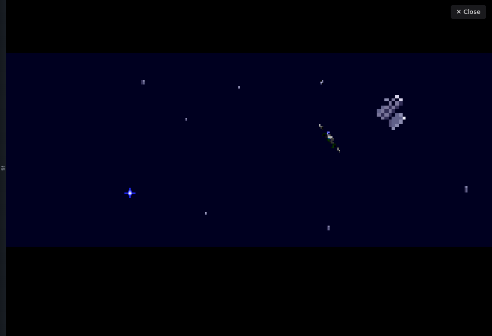

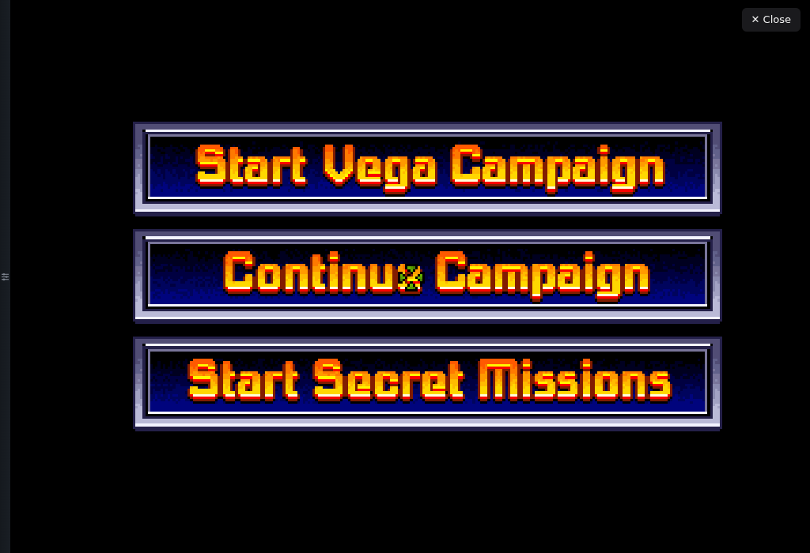

Known issues:
- js-dos's DOSBox-X build crashes on some eXo launcher batch commands, so
  DOSBox-X is only used for 3dfx games; MT-32 music falls back to Sound
  Blaster/AdLib for now.

---

## Milestone 1 — Exodium UI in the browser, games play in-app (2026-10-07)

The unchanged Exodium frontend, served by the exodiumweb server against the
**eXoDOS 6.04** collection on the NAS (7,666 games). Search, open the detail
panel, press **Play**: the game boots in an in-app js-dos player; **Close**
returns to the library.

**Recording: search → detail → Play → Commander Keen 5 running → close**
([full video](01-keen5-play.webm))

**Library (Browse, title A–Z)**

**Detail panel**

**In the player**

Known issues in this milestone (fixed or planned next):
- "Starting…" stayed on top of the game (fixed after this recording).
- The desktop window buttons (minimise/maximise/close) still show top right.
- Manuals, media gallery, video previews and theme music aren't wired up yet.
